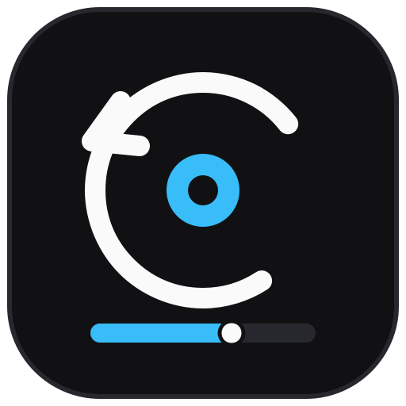
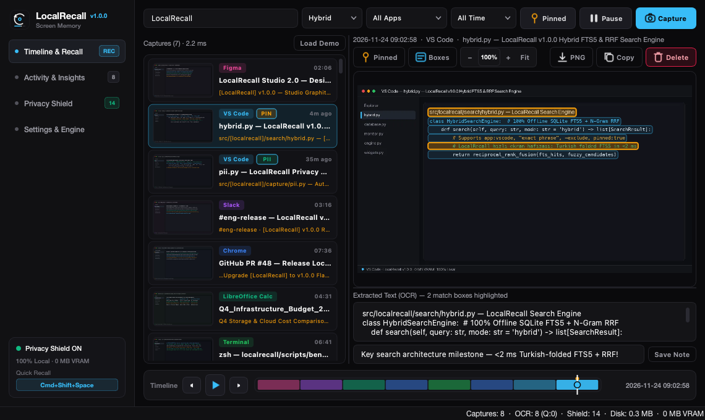
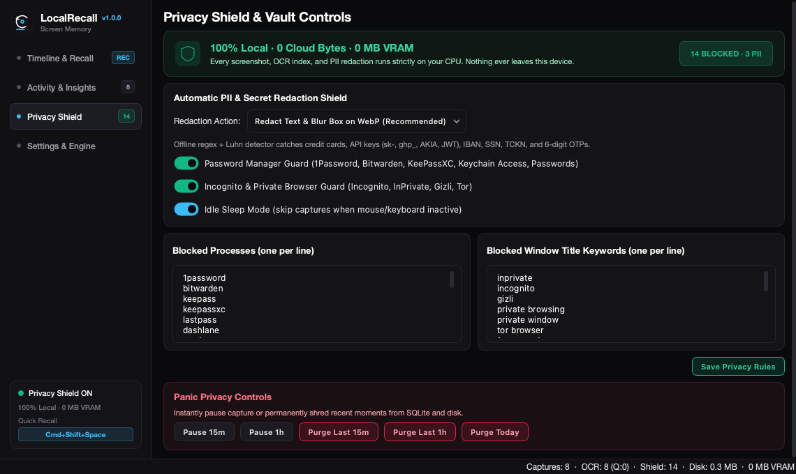
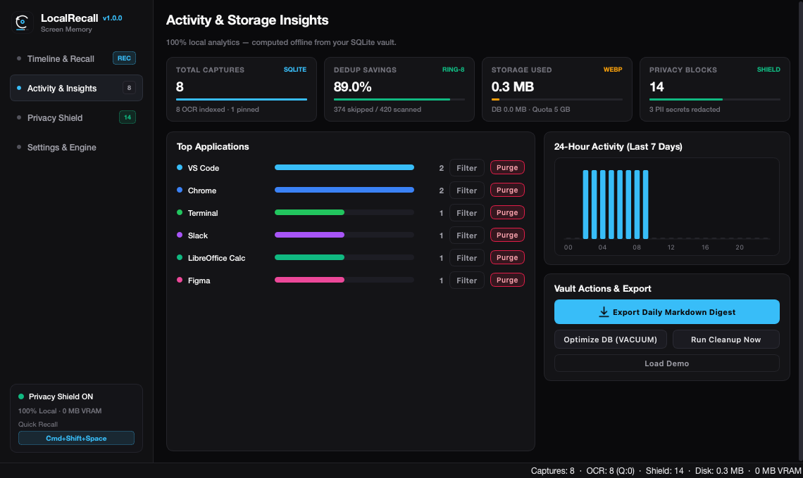
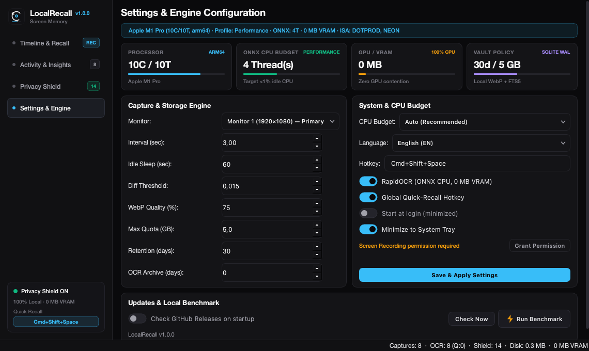
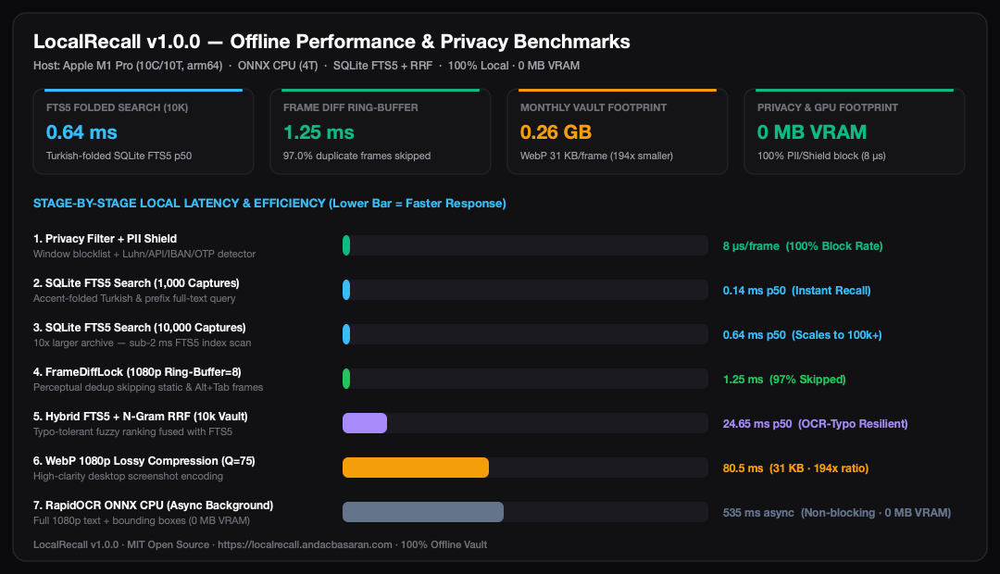
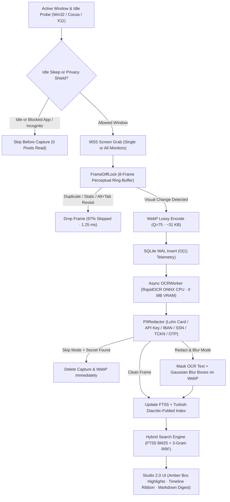

<div align="center">



# 🔍 LocalRecall — 100% Offline, Privacy-First Smart Screen Memory

**🇬🇧 English (Active)** · **🇹🇷 [Türkçe README](README.tr.md)** · **[💻 Compatibility Matrix](COMPATIBILITY.md)** · **[🤝 Contributing](CONTRIBUTING.md)** · **[🛡️ Security](SECURITY.md)** · **[📜 Changelog](CHANGELOG.md)**

**Sub-millisecond (`0.64 ms` FTS5), 100% offline, 0 MB VRAM open-source alternative to Windows Recall & Rewind — featuring RapidOCR ONNX CPU search, glowing bounding-box highlights, perceptual ring-buffer deduplication, automatic PII/secret blurring, and native Studio 2.0 apps for Windows x64, macOS Apple Silicon, and Linux.**

[](https://localrecall.andacbasaran.com)
[-2563EB?style=for-the-badge&logo=windows&logoColor=white)](https://localrecall.andacbasaran.com/downloads/LocalRecall.exe)
[-18181B?style=for-the-badge&logo=apple&logoColor=white)](https://localrecall.andacbasaran.com/downloads/LocalRecall-macOS.dmg)
[-E95420?style=for-the-badge&logo=linux&logoColor=white)](https://localrecall.andacbasaran.com/downloads/LocalRecall-Linux.tar.gz)
[](https://github.com/Andacbasaran/LocalRecall/releases/latest)

[](https://github.com/Andacbasaran/LocalRecall/actions/workflows/ci.yml)
[](https://github.com/Andacbasaran/LocalRecall/releases/latest)
[](https://github.com/Andacbasaran/LocalRecall/releases)
[](https://github.com/Andacbasaran/LocalRecall/stargazers)
[](https://www.python.org/)
[-41CD52?style=flat-square&logo=qt&logoColor=white)](https://pypi.org/project/PyQt6/)
[](https://github.com/RapidAI/RapidOCR)
[-10B981?style=flat-square)](#)
[](LICENSE)

<br/>

[**✨ Why LocalRecall?**](#-why-localrecall-whats-new-in-v100) · [**🖥️ Interface**](#️-studio-20-interface) · [**⚖️ Comparison**](#️-how-it-compares) · [**🚀 Download & Install**](#-download--installation) · [**⌨️ Hotkeys & Operators**](#️-global-hotkeys--search-operators) · [**📊 Benchmarks**](#-performance-benchmarks) · [**🏗️ Architecture**](#️-offline-pipeline-architecture) · [**📂 Project Structure**](#-project-structure) · [**🗺️ Roadmap**](#️-roadmap)

</div>

---

## ✨ Why LocalRecall? (What's New in v1.0.0)

Ever forgot which Slack thread, terminal log, Pull Request, or spreadsheet had that one command, number, or design note you saw two days ago? **LocalRecall** builds a **100% local, zero-cloud, searchable visual timeline** of your screen — running strictly on your CPU (**0 MB VRAM**, **0 cloud bytes**, **zero subscriptions**).

<table>
  <tr>
    <td width="50%">
      <b>🛡️ Defense-in-Depth Privacy Shield &amp; PII Blur</b><br/>
      Automatically skips password managers (<code>1Password</code>, <code>Bitwarden</code>, <code>KeePassXC</code>, <code>Keychain Access</code>, <code>Passwords</code>, <code>gnome-keyring</code>) &amp; private tabs (<code>Incognito</code>, <code>InPrivate</code>, <code>Gizli</code>, <code>Tor</code>) <b>before capture</b>, plus redacts &amp; blurs credit cards (Luhn), API keys (<code>sk-</code>, <code>ghp_</code>, <code>AKIA</code>, JWT), IBAN, SSN, TCKN, and 6-digit OTPs in <code>8.3 µs</code>.
    </td>
    <td width="50%">
      <b>⚡ Sub-Millisecond Hybrid FTS5 + N-Gram RRF Search</b><br/>
      Queries <b>10,000+ captures in <code>0.64 ms</code> p50</b> with Turkish &amp; Unicode diacritic folding (<code>şifre ↔ sifre</code>, <code>hızlı ↔ hizli</code>), OCR-typo resilient RRF ranking, and power operators (<code>app:code</code>, <code>"exact phrase"</code>, <code>-exclude</code>, <code>pinned:true</code>).
    </td>
  </tr>
  <tr>
    <td width="50%">
      <b>🎯 Interactive OCR Canvas &amp; Click-to-Copy Highlights</b><br/>
      RapidOCR (ONNX CPU, <b>0 MB VRAM</b>) extracts text and normalized bounding boxes. Matching phrases glow in <b>Amber</b> right on the screenshot — click any text box to copy, zoom/pan <code>50%–400%</code>, pin moments, add notes, or export annotated PNGs.
    </td>
    <td width="50%">
      <b>🪶 Ring-Buffer Dedup &amp; Ultra-Compact WebP Vault</b><br/>
      8-frame perceptual <code>FrameDiffLock</code> skips static scenes &amp; <code>Alt+Tab</code> revisits in <code>1.25 ms</code> (<b>97% skip ratio</b>), while idle sleep pauses on inactivity. 1080p frames compress <b>194×</b> to <code>~31 KB</code> WebP (~<code>0.26 GB/month</code>), plus optional <b>OCR-Only Archival Mode</b> &amp; FIFO quotas.
    </td>
  </tr>
  <tr>
    <td width="50%">
      <b>🖥️ Studio 2.0 4-Page Workspace &amp; Visual Timeline</b><br/>
      Scrub across an <b>app-colored visual timeline ribbon</b> with rewind playback, inspect O(1) SQLite analytics &amp; 24-hour activity charts, export <b>Daily Markdown Digests</b>, or try the 1-click <b>8-frame Demo Timeline</b> instantly.
    </td>
    <td width="50%">
      <b>🌍 Native Cross-Platform &amp; Bilingual EN / TR</b><br/>
      Native installers and OS integrations for <b>Windows 10/11 (x64)</b>, <b>macOS Apple Silicon (arm64)</b>, and <b>Linux (x86_64)</b> — including system tray panic-wipe controls, adaptive CPU profiles (<code>Eco / Balanced / Performance</code>), and live EN/TR switching.
    </td>
  </tr>
</table>

---

## 🖥️ Studio 2.0 Interface

<div align="center">
  
</div>

<details>
<summary><b>📸 View All 4 Studio 2.0 Views (Privacy Shield &amp; Panic Wipe · Activity &amp; Insights · Settings &amp; Engine)</b></summary>
<br/>
<div align="center">
  <p><b>Tab 3 — Privacy Shield, Automatic PII/Secret Redaction &amp; Panic Wipe Controls</b></p>
  
  <br/><br/>
  <p><b>Tab 2 — Activity &amp; Storage Insights (Top Apps, 24-Hour Chart &amp; Daily Markdown Digest)</b></p>
  
  <br/><br/>
  <p><b>Tab 4 — Settings &amp; Engine (Hardware/ISA Detection, CPU Thread Budget, Multi-Monitor &amp; Auto-Updater)</b></p>
  
</div>
</details>

---

## ⚖️ How It Compares

| Feature | 🔍 LocalRecall v1.0.0 | Windows Recall *(Copilot+ PC)* | Rewind / Limitless | Cloud Screenshot Tools |
| :--- | :---: | :---: | :---: | :---: |
| **100% Open Source & Auditable** | **Yes (MIT)** | No *(Proprietary OS)* | No *(Proprietary)* | No |
| **Hardware Requirement** | **Any CPU · 0 MB VRAM** | Requires 40+ TOPS NPU | Apple Silicon Mac only | Any |
| **Cross-Platform OS** | **Windows · macOS · Linux** | Windows 11 Copilot+ only | macOS / iOS only | Web / Desktop |
| **Zero Cloud Bytes (100% Local)** | **Yes (Air-Gapped)** | Local + Microsoft ecosystem | Optional cloud sync | Cloud uploaded |
| **Pre-Capture Password Manager Guard** | **Yes (19 built-in + custom)** | Partial / App-based | Manual blocklist | No |
| **Auto PII & Secret Redaction + Blur** | **Yes (`8.3 µs` · Luhn/API/IBAN/OTP)** | Sensitive info filter | Limited | No |
| **Search Speed (10k Captures)** | **`0.64 ms` FTS5 + Hybrid RRF** | Semantic / NPU | Fast local | Network latency |
| **Turkish & Unicode Diacritic Folding** | **Native (`ş↔s`, `ı↔i`, `ğ↔g`)** | Limited | Limited | Varies |
| **OCR-Only Archival & Storage Quota** | **Yes (FIFO + Pin Protection)** | Fixed disk slider | Paid storage | Paid quota |
| **Pricing** | **100% Free Forever** | Bundled w/ Copilot+ PC | Subscription (`$19–$29/mo`) | Subscription |

---

## 🚀 Download & Installation

### Windows (x64 — Windows 10 / 11)
- **Full Installer (Recommended):** Download [**LocalRecall.exe**](https://localrecall.andacbasaran.com/downloads/LocalRecall.exe) (`LocalRecall-Setup-v1.0.0-Windows-x64.exe`, bilingual EN/TR wizard with optional autostart and clean vault uninstall).
- **Portable ZIP (No Install):** Download `LocalRecall-Portable-v1.0.0-Windows-x64.zip` from [GitHub Releases](https://github.com/Andacbasaran/LocalRecall/releases/latest).
- **Package Managers:** Ready-to-use manifests are maintained in [`packaging/winget/`](packaging/winget/) and [`packaging/scoop/`](packaging/scoop/).

### macOS (Apple Silicon M1–M4)
- **Native DMG (Recommended):** Download [**LocalRecall-macOS.dmg**](https://localrecall.andacbasaran.com/downloads/LocalRecall-macOS.dmg) (`LocalRecall-v1.0.0-macOS-arm64.dmg`), drag **LocalRecall.app** into `Applications`, and launch.
- **Homebrew Cask:** Cask formula is available in [`packaging/homebrew/localrecall.rb`](packaging/homebrew/localrecall.rb).
- *First-launch tip:* LocalRecall is free MIT open-source software without a paid Apple notarization certificate. If Gatekeeper prompts on first launch, run `xattr -cr "/Applications/LocalRecall.app"` (or click *Open Anyway* in *System Settings → Privacy & Security*), then enable **Screen & System Audio Recording** for LocalRecall.

### Linux (x86_64)
- **Prebuilt Linux Archive (Recommended):** Download [**LocalRecall-Linux.tar.gz**](https://localrecall.andacbasaran.com/downloads/LocalRecall-Linux.tar.gz) (`LocalRecall-v1.0.0-Linux-x86_64.tar.gz`), extract, and run `./LocalRecall/LocalRecall`.
- **Desktop Integration & AppDir:** `AppRun` and `.desktop` entry live in [`packaging/linux/`](packaging/linux/). On X11, install `xdotool` and `xprintidle` for full active-window privacy detection and idle sleep.

### From Source (Developer Setup)
```bash
git clone https://github.com/Andacbasaran/LocalRecall.git
cd LocalRecall

# Quick auto-setup launcher (macOS / Linux)
./scripts/start.sh

# Windows quick launcher
scripts\baslat.bat
```

Or configure a virtual environment manually:
```bash
python -m venv .venv
# Windows: .\.venv\Scripts\activate  |  macOS/Linux: source .venv/bin/activate
pip install --prefer-binary -r requirements.txt
pip install -e . --no-deps
python main.py              # Launch Studio 2.0 UI
python main.py --minimized  # Launch quietly into the system tray
```

---

## ⌨️ Global Hotkeys & Search Operators

### Keyboard Shortcuts

| Shortcut | Scope | Action |
| :---: | :---: | :--- |
| **`Ctrl+Shift+Space`** *(Win/Linux)* / **`Cmd+Shift+Space`** *(macOS)* | Global | Summon LocalRecall to front and focus search *(customizable in Settings)* |
| **`Ctrl+F`** | In-App | Focus and select the search command bar |
| **`Alt+Left` / `Alt+Right`** | In-App | Step backward / forward along the visual timeline |
| **`Ctrl + Mouse Wheel`** | Preview | Smooth zoom `50% – 400%` + left-drag pan *(double-click to reset)* |
| **`Click OCR Box`** | Preview | Copy that exact on-screen text region directly to clipboard |
| **`Delete`** | In-App | Permanently delete the currently selected capture |

### Structured Search Operators

Combine natural keywords with precision operators right inside the search bar:

| Operator | Example | Effect |
| :--- | :--- | :--- |
| **`app:<name>`** | `app:vscode migration` | Restrict matches to apps whose name contains `vscode` |
| **`app:"<name>"`** | `app:"LibreOffice Calc" budget` | Match multi-word application names |
| **`"exact phrase"`** | `"SQLite FTS5" benchmark` | Require an exact phrase match |
| **`-exclude`** | `LocalRecall -slack` | Exclude captures containing the negated word or `-"phrase"` |
| **`pinned:true`** / **`is:pinned`** | `pinned:true architecture` | Search only bookmarked / pinned moments |
| **Turkish Diacritic Folding** | `hizli sifre` | Automatically finds `hızlı şifre` across 100k+ indexed captures |

---

## 📊 Performance Benchmarks

Measured locally on **Apple M1 Pro (10C/10T, arm64 · Darwin)** with **ONNX Runtime CPU (4 threads)** and **0 MB VRAM** (`benchmark_results.json`):

<div align="center">
  
</div>

| Pipeline Stage | Measured Result | Notes |
| :--- | :---: | :--- |
| **1. Privacy Shield + PII Redaction** | **`8.3 µs / frame`** | **100.0% block rate** across password managers, incognito & secrets |
| **2. SQLite FTS5 Folded Search (1,000 rows)** | **`0.14 ms` p50** | Instant accent-folded & prefix full-text recall |
| **3. SQLite FTS5 Folded Search (10,000 rows)** | **`0.64 ms` p50** | Scales cleanly beyond 100k+ rows in WAL mode |
| **4. FrameDiffLock (`1080p`, Ring-Buffer=8)** | **`1.25 ms / frame`** | **97.0% duplicate frames skipped** (static + `Alt+Tab` revisits) |
| **5. Hybrid FTS5 + N-Gram RRF (10k Vault)** | **`24.65 ms` p50** | OCR-typo tolerant fuzzy fusion (`LocaIRecall` → `LocalRecall`) |
| **6. WebP 1080p Lossy Encoding (`Q=75`)** | **`31.3 KB / frame`** | **194.1× compression** (`80.45 ms` encode · `~0.26 GB/month` projected) |
| **7. RapidOCR ONNX CPU (`1080p` Async)** | **`534.9 ms` async** | Non-blocking background thread · **0 MB VRAM** |

Reproduce these benchmarks or run the automated test suite on your own machine:
```bash
# Run hardware & pipeline benchmarks + regenerate charts
QT_QPA_PLATFORM=offscreen python scripts/benchmark.py

# Run full unit & offscreen Studio 2.0 UI test suite
QT_QPA_PLATFORM=offscreen pytest -v

# Run Ruff static lint check
ruff check .
```

---

## 🏗️ Offline Pipeline Architecture



---

## 📂 Project Structure

```text
├── main.py                                    # Single-instance entry point, crash logger, hotkey & tray wiring
├── build.py                                   # Root convenience wrapper forwarding to scripts/build_exe.py
├── src/localrecall/
│   ├── __init__.py                            # App metadata, version (1.0.0) & bundle ID
│   ├── config.py                              # Persistent JSON AppConfig & cross-platform login autostart
│   ├── hardware.py                            # Universal CPU/ISA detection & Eco/Balanced/Performance ONNX budget
│   ├── i18n.py                                # Full bilingual English (EN) & Turkish (TR) LanguageManager
│   ├── demo.py                                # 8-frame synthetic Demo Timeline & Daily Markdown Digest exporter
│   ├── updater.py                             # Async GitHub Releases SemVer auto-updater with SHA-256 verification
│   ├── capture/
│   │   ├── monitor.py                         # CaptureService loop, timed pause, retention, archival & quota FIFO
│   │   ├── diff.py                            # 8-frame perceptual ring-buffer FrameDiffLock
│   │   ├── privacy.py                         # Extensionless Password Manager & Incognito PrivacyFilter
│   │   ├── pii.py                             # Offline Luhn/API/JWT/IBAN/SSN/TCKN/OTP redactor & WebP blurrer
│   │   └── window_info.py                     # Win32 / macOS CoreGraphics+NSWorkspace / Linux X11 window & idle APIs
│   ├── ocr/
│   │   └── engine.py                          # RapidOCR ONNX CPU engine (non-ASCII path safe) & startup backfill worker
│   ├── storage/
│   │   ├── database.py                        # Thread-safe SQLite WAL + FTS5 Turkish-folded index & O(1) telemetry
│   │   └── media.py                           # Date-bucketed WebP MediaStore with size accounting
│   ├── search/
│   │   └── hybrid.py                          # Structured query parser (app:, -exclude, pinned:) + FTS5/N-Gram RRF
│   └── ui/
│       ├── main_window.py                     # Studio 2.0 4-page sidebar window & async search/thumbnail workers
│       ├── preview_widget.py                  # Interactive 50–400% zoom/pan canvas, Amber highlights & annotated PNG
│       ├── widgets.py                         # HiDPI vector icons, FlatSwitch, FlatComboBox, TelemetryCard & TimelineRibbon
│       ├── theme.py                           # Studio Graphite QSS theme with Sky Blue / Emerald / Amber tokens
│       ├── hotkey.py                          # Cross-platform global hotkey manager
│       ├── tray.py                            # HiDPI system tray menu with Panic Wipe & timed pause actions
│       ├── settings_dialog.py                 # Standalone settings dialog helper
│       └── stats_dialog.py                    # Standalone vault statistics dialog helper
├── scripts/                                   # benchmark.py, build_exe.py, build_macos.py, build_linux.py, start.sh, baslat.bat
├── packaging/                                 # Inno Setup (TR/EN), Winget, Scoop, Homebrew Cask, Linux AppRun/desktop, SignPath
├── assets/                                    # Obsidian Rewind-Eye icons (.svg/.png/.ico/.icns), 4 Studio previews & chart
├── tests/                                     # Unit, PII/privacy, cross-platform & offscreen Studio 2.0 UI test suite
└── .github/                                   # 3-OS CI matrix (ci.yml), unified Release workflow (release.yml) & templates
```

---

## 🗺️ Roadmap

- [x] **Studio 2.0 4-Page Desktop Interface & App-Colored Visual Timeline** — Shipped in v1.0.0.
- [x] **Native Windows x64, macOS Apple Silicon & Linux x86_64 Packaging** — Shipped in v1.0.0.
- [x] **Automatic Offline PII & Secret Redaction + WebP Region Blurring** — Shipped in v1.0.0.
- [x] **Sub-Millisecond Turkish Diacritic-Folded SQLite FTS5 + Structured Operators** — Shipped in v1.0.0.
- [x] **OCR-Only Archival Mode, Storage Quotas & Daily Markdown Digest Export** — Shipped in v1.0.0.
- [ ] **Optional Local Semantic Embeddings (ONNX MiniLM CPU)** — Concept search ("that chart about cloud costs") with 0 MB VRAM.
- [ ] **Optional At-Rest SQLCipher Vault Encryption** — Passphrase-protected local SQLite & WebP container.
- [ ] **Native Wayland PipeWire Portal Capture** — First-class capture & window metadata on GNOME/KDE Wayland.

---

## 🧩 Local-First Open-Source Ecosystem

LocalRecall is part of a 100% offline, 0 MB VRAM desktop AI suite by [Andaç Başaran](https://github.com/Andacbasaran):

| Project | Purpose | Links |
| :--- | :--- | :--- |
| **🔍 LocalRecall** | 100% offline smart screen memory, OCR search & PII shield | [Website](https://localrecall.andacbasaran.com) · [GitHub](https://github.com/Andacbasaran/LocalRecall) |
| **⚡ SubVision AI** | Real-time offline game, movie & stream subtitle translator | [Website](https://subvisionai.andacbasaran.com) · [GitHub](https://github.com/Andacbasaran/subvision-ai-subtitle-translator) |
| **🎙️ LocalDictate** | 100% offline desktop AI voice dictation & translation studio | [Website](https://localdictate.andacbasaran.com) · [GitHub](https://github.com/Andacbasaran/LocalDictate) |
| **🎧 ClearMic** | 100% offline AI microphone noise suppression & broadcast DSP | [GitHub](https://github.com/Andacbasaran/ClearMic) |
| **📝 LocalMinutes** | Bot-free offline live meeting & lecture transcriber + summarizer | [GitHub](https://github.com/Andacbasaran/LocalMinutes) |

---

## 🤝 Contributing, Privacy & License

Contributions, OS/Wayland compatibility reports, new privacy rules, and UI polish are warmly welcome!
- Read [CONTRIBUTING.md](CONTRIBUTING.md) to get started.
- Check [COMPATIBILITY.md](COMPATIBILITY.md) for Windows, macOS TCC, and Linux X11/Wayland details.
- Review [SECURITY.md](SECURITY.md) for our zero-cloud guarantees and `SHA256SUMS.txt` binary verification guide.

If **LocalRecall** saves you time without sacrificing your privacy, consider giving the repository a **⭐ Star** on GitHub!

Licensed under the **[MIT License](LICENSE)**.
