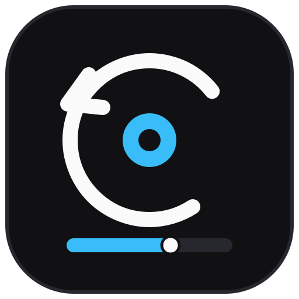
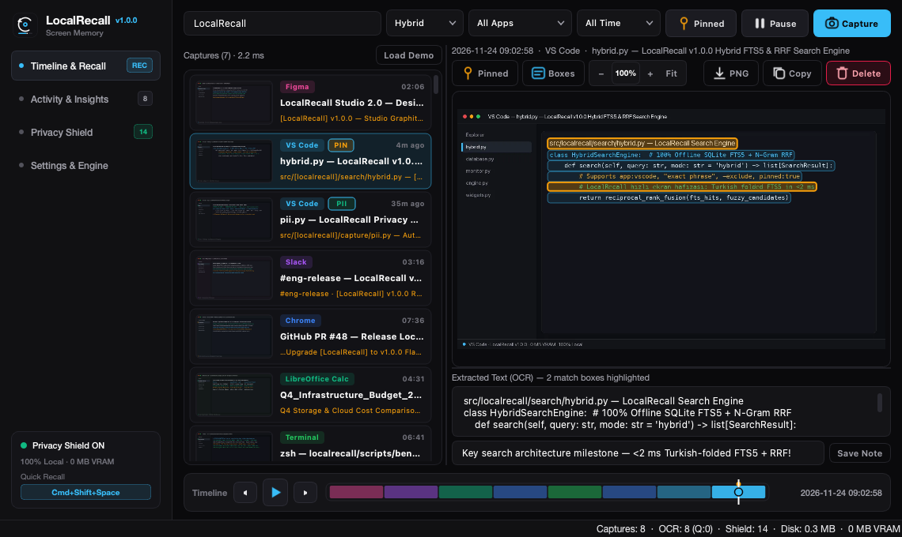
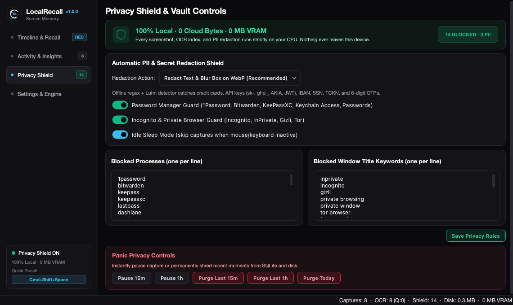
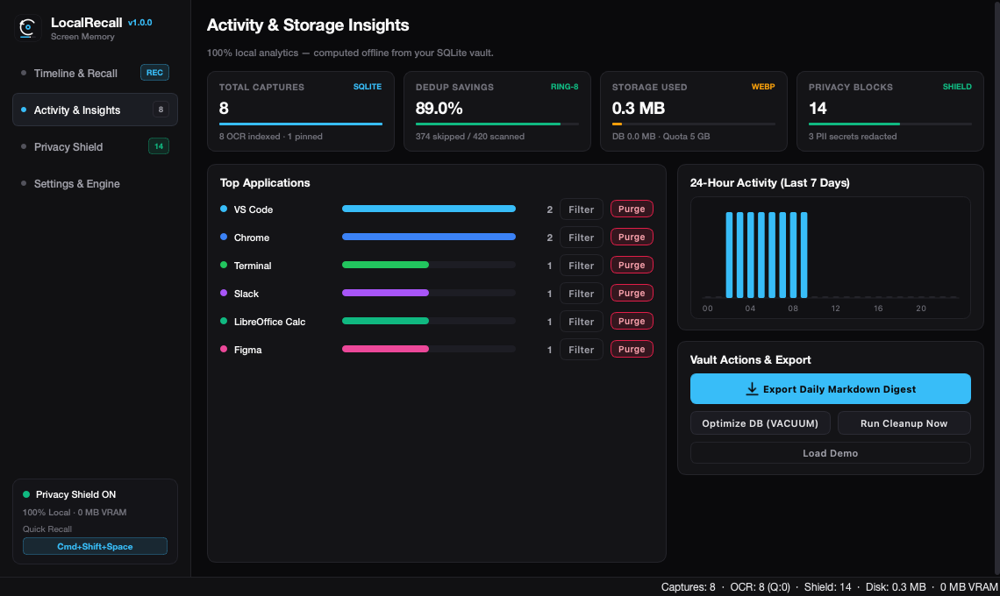
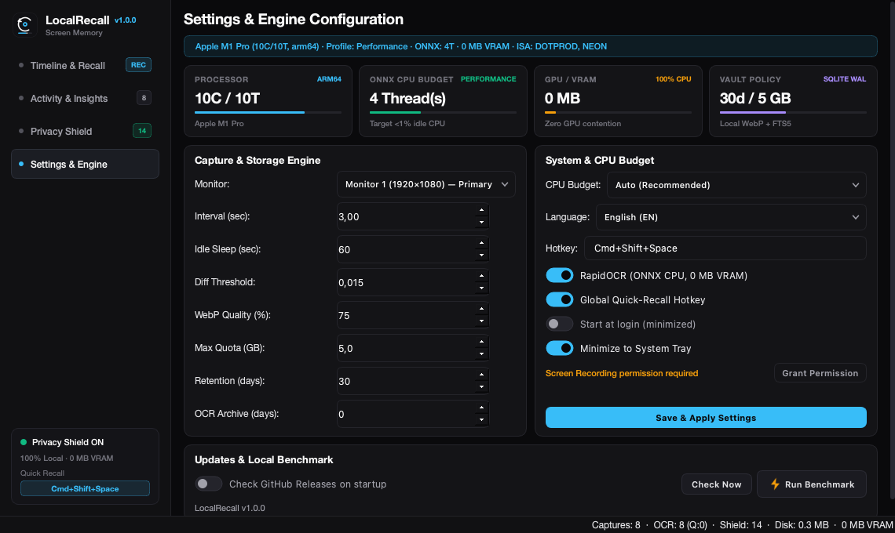
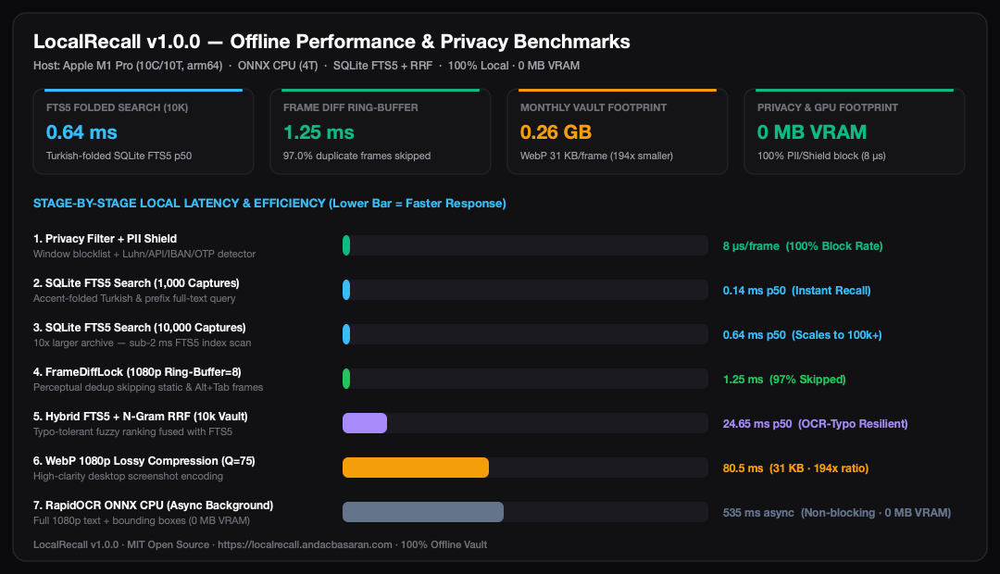
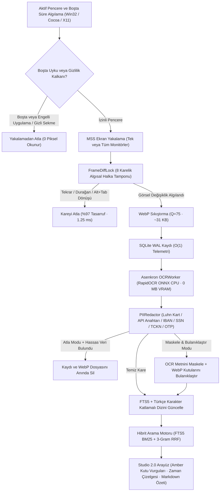

<div align="center">



# 🔍 LocalRecall — %100 Çevrimdışı, Gizlilik Odaklı Akıllı Ekran Hafızası

**🇬🇧 [English README](README.md)** · **🇹🇷 Türkçe (Aktif)** · **[💻 Uyumluluk Matrisi](COMPATIBILITY.md)** · **[🤝 Katkı Rehberi](CONTRIBUTING.md)** · **[🛡️ Güvenlik](SECURITY.md)** · **[📜 Sürüm Notları](CHANGELOG.md)**

**Milisaniye altı (`0.64 ms` FTS5), %100 çevrimdışı, 0 MB VRAM açık kaynaklı Windows Recall & Rewind alternatifi — RapidOCR ONNX CPU arama, ekran üzerinde parlayan metin vurguları, algısal halka tamponlu tekilleştirme, otomatik PII/gizli anahtar bulanıklaştırma ve Windows x64, macOS Apple Silicon ve Linux için yerel Studio 2.0 deneyimi.**

[](https://localrecall.andacbasaran.com)
[-2563EB?style=for-the-badge&logo=windows&logoColor=white)](https://localrecall.andacbasaran.com/downloads/LocalRecall.exe)
[-18181B?style=for-the-badge&logo=apple&logoColor=white)](https://localrecall.andacbasaran.com/downloads/LocalRecall-macOS.dmg)
[-E95420?style=for-the-badge&logo=linux&logoColor=white)](https://localrecall.andacbasaran.com/downloads/LocalRecall-Linux.tar.gz)
[](https://github.com/Andacbasaran/LocalRecall/releases/latest)

[](https://github.com/Andacbasaran/LocalRecall/actions/workflows/ci.yml)
[](https://github.com/Andacbasaran/LocalRecall/releases/latest)
[](https://github.com/Andacbasaran/LocalRecall/releases)
[](https://github.com/Andacbasaran/LocalRecall/stargazers)
[](https://www.python.org/)
[-41CD52?style=flat-square&logo=qt&logoColor=white)](https://pypi.org/project/PyQt6/)
[](https://github.com/RapidAI/RapidOCR)
[-10B981?style=flat-square)](#)
[](LICENSE)

<br/>

[**✨ Neden LocalRecall?**](#-neden-localrecall-v100-yenilikleri) · [**🖥️ Arayüz**](#️-studio-20-arayüzü) · [**⚖️ Karşılaştırma**](#️-karşılaştırma) · [**🚀 İndirme & Kurulum**](#-indirme-ve-kurulum) · [**⌨️ Kısayollar & Operatörler**](#️-global-kısayollar-ve-arama-operatörleri) · [**📊 Performans Testleri**](#-performans-testleri-benchmarks) · [**🏗️ Mimari**](#️-çevrimdışı-işlem-mimarisi) · [**📂 Proje Yapısı**](#-proje-yapısı) · [**🗺️ Yol Haritası**](#️-yol-haritası)

</div>

---

## ✨ Neden LocalRecall? (v1.0.0 Yenilikleri)

İki gün önce hangi Slack kanalında, terminal çıktısında, Pull Request'te veya tabloda gördüğünüz o komutu, rakamı ya da notu hatırlamaya mı çalışıyorsunuz? **LocalRecall**, ekranınızın **%100 yerel, bulutsuz ve anında aranabilir görsel zaman çizelgesini** oluşturur — yalnızca işlemcinizde çalışır (**0 MB VRAM**, **0 bayt bulut**, **abonelik yok**).

<table>
  <tr>
    <td width="50%">
      <b>🛡️ Katmanlı Gizlilik Kalkanı ve Otomatik PII Bulanıklaştırma</b><br/>
      Şifre yöneticilerini (<code>1Password</code>, <code>Bitwarden</code>, <code>KeePassXC</code>, <code>Keychain Access</code>, <code>Passwords</code>, <code>gnome-keyring</code>) ve gizli sekmeleri (<code>Gizli</code>, <code>Incognito</code>, <code>InPrivate</code>, <code>Tor</code>) <b>ekran yakalanmadan önce</b> engeller; kredi kartı (Luhn), API anahtarı (<code>sk-</code>, <code>ghp_</code>, <code>AKIA</code>, JWT), IBAN, SSN, TCKN ve 6 haneli OTP kodlarını <code>8.3 µs</code> içinde maskeler ve WebP üzerinde bulanıklaştırır.
    </td>
    <td width="50%">
      <b>⚡ Milisaniye Altı Hibrit FTS5 + N-Gram RRF Arama</b><br/>
      <b>10.000+ kaydı <code>0.64 ms</code> p50</b> hızında tarar; Türkçe karakter katlama (<code>şifre ↔ sifre</code>, <code>hızlı ↔ hizli</code>), OCR yazım hatasına dayanıklı RRF sıralama ve gelişmiş operatörler (<code>app:code</code>, <code>"tam ifade"</code>, <code>-hariç</code>, <code>pinned:true</code>) sunar.
    </td>
  </tr>
  <tr>
    <td width="50%">
      <b>🎯 Etkileşimli OCR Tuvali ve Tek Tıkla Kopyalama</b><br/>
      RapidOCR (ONNX CPU, <b>0 MB VRAM</b>) ekrandaki tüm metinleri ve konumlarını çıkarır. Eşleşen kelimeler ekran görüntüsü üzerinde <b>Amber</b> kutularla parlar — herhangi bir metin kutusuna tıklayarak kopyalayın, <code>%50–%400</code> yakınlaştırın, anları sabitleyin, not ekleyin veya işaretli PNG dışa aktarın.
    </td>
    <td width="50%">
      <b>🪶 Halka Tamponlu Tekilleştirme ve Ultra Kompakt WebP Kasa</b><br/>
      8 karelik algısal <code>FrameDiffLock</code> durağan ekranları ve <code>Alt+Tab</code> dönüşlerini <code>1.25 ms</code> içinde atlar (<b>%97 atlama oranı</b>); boşta uyku modu hareketsizlikte duraklar. 1080p kareler <b>194×</b> sıkıştırılarak <code>~31 KB</code> WebP olur (~<code>0.26 GB/ay</code>). Ayrıca <b>Yalnızca OCR Arşiv Modu</b> ve FIFO disk kotası içerir.
    </td>
  </tr>
  <tr>
    <td width="50%">
      <b>🖥️ Studio 2.0 4 Sayfalı Çalışma Alanı ve Görsel Zaman Çizelgesi</b><br/>
      <b>Uygulama renkli zaman çizelgesi şeridinde</b> geri sararak gezinin, O(1) SQLite analizlerini ve 24 saatlik aktivite grafiğini inceleyin, <b>Günlük Markdown Özeti</b> dışa aktarın veya tek tıkla <b>8 karelik Demo Zaman Çizelgesini</b> deneyin.
    </td>
    <td width="50%">
      <b>🌍 Tam Çoklu Platform ve Çift Dilli (TR / EN) Deneyim</b><br/>
      <b>Windows 10/11 (x64)</b>, <b>macOS Apple Silicon (arm64)</b> ve <b>Linux (x86_64)</b> için yerel paketler — sistem tepsisinden acil gizlilik temizliği (Panic Wipe), adaptif CPU profilleri (<code>Eko / Dengeli / Performans</code>) ve anlık TR/EN dil değiştirme.
    </td>
  </tr>
</table>

---

## 🖥️ Studio 2.0 Arayüzü

<div align="center">
  
</div>

<details>
<summary><b>📸 Tüm 4 Studio 2.0 Ekranını Görüntüle (Gizlilik Kalkanı &amp; Panic Wipe · Aktivite &amp; Analiz · Ayarlar &amp; Motor)</b></summary>
<br/>
<div align="center">
  <p><b>Sekme 3 — Gizlilik Kalkanı, Otomatik PII/Anahtar Maskeleme ve Acil Temizlik (Panic Wipe)</b></p>
  
  <br/><br/>
  <p><b>Sekme 2 — Aktivite ve Depolama Analizi (En Çok Kullanılan Uygulamalar, 24 Saat Grafiği &amp; Markdown Özeti)</b></p>
  
  <br/><br/>
  <p><b>Sekme 4 — Ayarlar ve Motor (Donanım/ISA Algılama, CPU Bütçesi, Çoklu Monitör ve Otomatik Güncelleyici)</b></p>
  
</div>
</details>

---

## ⚖️ Karşılaştırma

| Özellik | 🔍 LocalRecall v1.0.0 | Windows Recall *(Copilot+ PC)* | Rewind / Limitless | Bulut Ekran Görüntüsü Araçları |
| :--- | :---: | :---: | :---: | :---: |
| **%100 Açık Kaynak ve Denetlenebilir** | **Evet (MIT)** | Hayır *(Kapalı İşletim Sistemi)* | Hayır *(Kapalı Kaynak)* | Hayır |
| **Donanım Gereksinimi** | **Herhangi bir CPU · 0 MB VRAM** | 40+ TOPS NPU şart | Yalnızca Apple Silicon Mac | Herhangi biri |
| **Platform Desteği** | **Windows · macOS · Linux** | Yalnızca Windows 11 Copilot+ | Yalnızca macOS / iOS | Web / Masaüstü |
| **0 Bayt Bulut (%100 Yerel)** | **Evet (Tam Çevrimdışı)** | Yerel + Microsoft ekosistemi | Opsiyonel bulut senkron | Buluta yüklenir |
| **Yakalama Öncesi Şifre Yöneticisi Koruması** | **Evet (19 yerleşik + özel)** | Kısmi / Uygulama bazlı | Manuel engelleme listesi | Hayır |
| **Otomatik PII/Anahtar Maskeleme & Bulanıklaştırma** | **Evet (`8.3 µs` · Luhn/API/IBAN/OTP)** | Hassas veri filtresi | Sınırlı | Hayır |
| **Arama Hızı (10.000 Kayıt)** | **`0.64 ms` FTS5 + Hibrit RRF** | Semantik / NPU | Hızlı yerel | Ağ gecikmesi |
| **Türkçe Karakter Katlama (`ş↔s`, `ı↔i`)** | **Yerleşik (100k+ kayıt ölçeği)** | Sınırlı | Sınırlı | Değişken |
| **Yalnızca OCR Arşivi & Disk Kotası** | **Evet (FIFO + Sabitli Koruması)** | Sabit disk sınırı | Ücretli depolama | Ücretli kota |
| **Fiyatlandırma** | **Sonsuza Dek %100 Ücretsiz** | Copilot+ PC ile birlikte | Abonelik (`$19–$29/ay`) | Abonelik |

---

## 🚀 İndirme ve Kurulum

### Windows (x64 — Windows 10 / 11)
- **Tam Kurulum Paketi (Önerilen):** [**LocalRecall.exe**](https://localrecall.andacbasaran.com/downloads/LocalRecall.exe) (`LocalRecall-Setup-v1.0.0-Windows-x64.exe` — Türkçe/İngilizce sihirbaz, isteğe bağlı başlangıçta çalışma ve opsiyonel kasa temizlemeli kaldırıcı).
- **Taşınabilir ZIP (Kurulumsuz):** [GitHub Releases](https://github.com/Andacbasaran/LocalRecall/releases/latest) sayfasından `LocalRecall-Portable-v1.0.0-Windows-x64.zip` dosyasını indirin.
- **Paket Yöneticileri:** Güncel manifestolar [`packaging/winget/`](packaging/winget/) ve [`packaging/scoop/`](packaging/scoop/) klasörlerinde yer alır.

### macOS (Apple Silicon M1–M4)
- **Yerel DMG (Önerilen):** [**LocalRecall-macOS.dmg**](https://localrecall.andacbasaran.com/downloads/LocalRecall-macOS.dmg) (`LocalRecall-v1.0.0-macOS-arm64.dmg`) dosyasını indirin, **LocalRecall.app** uygulamasını `Applications` klasörüne sürükleyin ve çalıştırın.
- **Homebrew Cask:** Cask tanımı [`packaging/homebrew/localrecall.rb`](packaging/homebrew/localrecall.rb) dosyasındadır.
- *İlk açılış notu:* LocalRecall ücretsiz MIT açık kaynak yazılımı olduğundan Apple ücretli noter sertifikasına sahip değildir. Gatekeeper uyarısı çıkarsa terminalde `xattr -cr "/Applications/LocalRecall.app"` çalıştırın (veya *Sistem Ayarları → Gizlilik ve Güvenlik → Yine de Aç* tıklayın), ardından **Ekran ve Sistem Sesi Kaydı** iznini etkinleştirin.

### Linux (x86_64)
- **Hazır Linux Paketi (Önerilen):** [**LocalRecall-Linux.tar.gz**](https://localrecall.andacbasaran.com/downloads/LocalRecall-Linux.tar.gz) (`LocalRecall-v1.0.0-Linux-x86_64.tar.gz`) arşivini açın ve `./LocalRecall/LocalRecall` ile çalıştırın.
- **Masaüstü Entegrasyonu & AppDir:** `AppRun` ve `.desktop` dosyası [`packaging/linux/`](packaging/linux/) içindedir. X11 üzerinde tam aktif pencere gizlilik filtresi ve boşta uyku için `xdotool` ve `xprintidle` paketlerini kurmanız önerilir.

### Kaynak Koddan Kurulum (Geliştiriciler İçin)
```bash
git clone https://github.com/Andacbasaran/LocalRecall.git
cd LocalRecall

# Hızlı otomatik kurulum başlatıcısı (macOS / Linux)
./scripts/start.sh

# Windows hızlı başlatıcı
scripts\baslat.bat
```

Veya sanal ortamı manuel kurun:
```bash
python -m venv .venv
# Windows: .\.venv\Scripts\activate  |  macOS/Linux: source .venv/bin/activate
pip install --prefer-binary -r requirements.txt
pip install -e . --no-deps
python main.py              # Studio 2.0 arayüzünü aç
python main.py --minimized  # Sistem tepsisinde sessiz başlat
```

---

## ⌨️ Global Kısayollar ve Arama Operatörleri

### Klavye Kısayolları

| Kısayol | Kapsam | İşlev |
| :---: | :---: | :--- |
| **`Ctrl+Shift+Space`** *(Win/Linux)* / **`Cmd+Shift+Space`** *(macOS)* | Sistem Geneli | LocalRecall'ı anında öne getir ve arama kutusuna odaklan *(Ayarlar'dan değiştirilebilir)* |
| **`Ctrl+F`** | Uygulama İçi | Arama komut çubuğuna odaklan ve metni seç |
| **`Alt+Sol` / `Alt+Sağ`** | Uygulama İçi | Görsel zaman çizelgesinde önceki / sonraki kayda geç |
| **`Ctrl + Fare Tekerleği`** | Önizleme | Akıcı yakınlaştırma `%50 – %400` + sol tıkla sürükle *(çift tıkla sıfırla)* |
| **`OCR Kutusuna Tıkla`** | Önizleme | Ekrandaki o metin bölgesini tek tıkla panoya kopyala |
| **`Delete`** | Uygulama İçi | Seçili ekran kaydını kalıcı olarak sil |

### Yapısal Arama Operatörleri

Normal kelimeleri güçlü filtre operatörleriyle birleştirerek saniyenin binde birinde nokta atışı arama yapın:

| Operatör | Örnek | İşlev |
| :--- | :--- | :--- |
| **`app:<ad>`** | `app:vscode migration` | Yalnızca uygulama adı `vscode` içeren kayıtları getirir |
| **`app:"<ad>"`** | `app:"LibreOffice Calc" bütçe` | Çok kelimeli uygulama adlarında filtreler |
| **`"tam ifade"`** | `"SQLite FTS5" benchmark` | Birebir ifade eşleşmesi arar |
| **`-hariç`** | `LocalRecall -slack` | Belirtilen kelimeyi veya `-"ifadeyi"` içeren kayıtları dışlar |
| **`pinned:true`** / **`is:pinned`** | `pinned:true mimari` | Yalnızca sabitlenmiş / yer imli anları arar |
| **Türkçe Karakter Katlama** | `hizli sifre` | 100.000+ kayıt arasında `hızlı şifre` eşleşmelerini anında bulur |

---

## 📊 Performans Testleri (Benchmarks)

**Apple M1 Pro (10C/10T, arm64 · Darwin)** üzerinde **ONNX Runtime CPU (4 iş parçacığı)** ve **0 MB VRAM** ile yerel olarak ölçülmüştür (`benchmark_results.json`):

<div align="center">
  
</div>

| İşlem Aşaması | Ölçülen Sonuç | Açıklama |
| :--- | :---: | :--- |
| **1. Gizlilik Kalkanı + PII Maskeleme** | **`8.3 µs / kare`** | Şifre yöneticileri, gizli sekmeler ve sırlarda **%100 engelleme** |
| **2. SQLite FTS5 Katlamalı Arama (1.000 kayıt)** | **`0.14 ms` p50** | Anlık Türkçe katlamalı ve önek tabanlı tam metin arama |
| **3. SQLite FTS5 Katlamalı Arama (10.000 kayıt)** | **`0.64 ms` p50** | WAL modunda 100.000+ kayda kadar milisaniye altı ölçeklenir |
| **4. FrameDiffLock (`1080p`, 8 Kare Halka Tampon)** | **`1.25 ms / kare`** | **%97.0 tekrar kare atlama** (durağan ekran + `Alt+Tab` dönüşleri) |
| **5. Hibrit FTS5 + N-Gram RRF (10k Kasa)** | **`24.65 ms` p50** | OCR yazım hatalarına dayanıklı bulanık sıralama (`LocaIRecall` → `LocalRecall`) |
| **6. WebP 1080p Sıkıştırma (`Q=75`)** | **`31.3 KB / kare`** | **194.1× sıkıştırma** (`80.45 ms` kodlama · tahmini `~0.26 GB/ay`) |
| **7. RapidOCR ONNX CPU (`1080p` Asenkron)** | **`534.9 ms` arka plan** | Arayüzü kilitlemeyen arka plan iş parçacığı · **0 MB VRAM** |

Kendi bilgisayarınızda ölçmek veya otomatik test paketini çalıştırmak için:
```bash
# Donanım & işlem hattı testlerini çalıştır ve grafikleri yenile
QT_QPA_PLATFORM=offscreen python scripts/benchmark.py

# Tüm birim ve offscreen Studio 2.0 arayüz testlerini çalıştır
QT_QPA_PLATFORM=offscreen pytest -v

# Ruff statik kod denetimi
ruff check .
```

---

## 🏗️ Çevrimdışı İşlem Mimarisi



---

## 📂 Proje Yapısı

```text
├── main.py                                    # Tekil örnek kilidi, çökme günlüğü, kısayol ve sistem tepsisi giriş noktası
├── build.py                                   # scripts/build_exe.py için kök derleme sarmalayıcısı
├── src/localrecall/
│   ├── __init__.py                            # Uygulama sürümü (1.0.0), depo ve kimlik bilgileri
│   ├── config.py                              # Kalıcı JSON AppConfig ve çoklu platform başlangıçta çalıştırma
│   ├── hardware.py                            # Evrensel CPU/ISA algılama ve Eko/Dengeli/Performans ONNX bütçesi
│   ├── i18n.py                                # Çift dilli İngilizce (EN) ve Türkçe (TR) LanguageManager
│   ├── demo.py                                # 8 karelik sentetik Demo Zaman Çizelgesi ve Günlük Markdown Özeti
│   ├── updater.py                             # SHA-256 doğrulamalı asenkron GitHub Releases SemVer güncelleyici
│   ├── capture/
│   │   ├── monitor.py                         # CaptureService döngüsü, süreli duraklatma, saklama, arşiv ve kota FIFO
│   │   ├── diff.py                            # 8 karelik algısal halka tamponlu FrameDiffLock
│   │   ├── privacy.py                         # Uzantı bağımsız Şifre Yöneticisi ve Gizli Sekme PrivacyFilter
│   │   ├── pii.py                             # Çevrimdışı Luhn/API/JWT/IBAN/SSN/TCKN/OTP maskeleyici ve WebP bulanıklaştırıcı
│   │   └── window_info.py                     # Win32 / macOS CoreGraphics+NSWorkspace / Linux X11 pencere ve boşta süre API'leri
│   ├── ocr/
│   │   └── engine.py                          # RapidOCR ONNX CPU motoru (Unicode yol uyumlu) ve başlangıç backfill işçisi
│   ├── storage/
│   │   ├── database.py                        # İş parçacığı güvenli SQLite WAL + Türkçe katlamalı FTS5 ve O(1) telemetri
│   │   └── media.py                           # Tarih klasörlü ve boyut takipçili WebP MediaStore
│   ├── search/
│   │   └── hybrid.py                          # Yapısal sorgu ayrıştırıcı (app:, -hariç, pinned:) + FTS5/N-Gram RRF
│   └── ui/
│       ├── main_window.py                     # Studio 2.0 4 sayfalı kenar çubuklu ana pencere ve asenkron arama/küçük resim
│       ├── preview_widget.py                  # %50–%400 yakınlaştırmalı tuval, Amber vurgular ve işaretli PNG dışa aktarma
│       ├── widgets.py                         # HiDPI vektör simgeler, FlatSwitch, FlatComboBox, TelemetryCard ve TimelineRibbon
│       ├── theme.py                           # Sky Blue / Emerald / Amber vurgulu Studio Graphite QSS teması
│       ├── hotkey.py                          # Çoklu platform global kısayol yöneticisi
│       ├── tray.py                            # Panic Wipe ve süreli duraklatma destekli HiDPI sistem tepsisi
│       ├── settings_dialog.py                 # Bağımsız ayar penceresi yardımcısı
│       └── stats_dialog.py                    # Bağımsız kasa istatistik penceresi yardımcısı
├── scripts/                                   # benchmark.py, build_exe.py, build_macos.py, build_linux.py, start.sh, baslat.bat
├── packaging/                                 # Inno Setup (TR/EN), Winget, Scoop, Homebrew Cask, Linux AppRun/desktop, SignPath
├── assets/                                    # Obsidian Rewind-Eye simgeleri (.svg/.png/.ico/.icns), 4 Studio önizlemesi ve grafik
├── tests/                                     # Birim, PII/gizlilik, çoklu platform ve offscreen Studio 2.0 arayüz testleri
└── .github/                                   # 3 işletim sistemli CI matrisi (ci.yml), birleşik Release (release.yml) ve şablonlar
```

---

## 🗺️ Yol Haritası

- [x] **Studio 2.0 4 Sayfalı Masaüstü Arayüzü ve Uygulama Renkli Zaman Çizelgesi** — v1.0.0 ile yayımlandı.
- [x] **Yerel Windows x64, macOS Apple Silicon ve Linux x86_64 Paketleme** — v1.0.0 ile yayımlandı.
- [x] **Otomatik Çevrimdışı PII & Gizli Anahtar Maskeleme + WebP Bölge Bulanıklaştırma** — v1.0.0 ile yayımlandı.
- [x] **Milisaniye Altı Türkçe Karakter Katlamalı SQLite FTS5 + Yapısal Arama Operatörleri** — v1.0.0 ile yayımlandı.
- [x] **Yalnızca OCR Arşiv Modu, Depolama Kotaları ve Günlük Markdown Özeti** — v1.0.0 ile yayımlandı.
- [ ] **Opsiyonel Yerel Semantik Gömme (ONNX MiniLM CPU)** — 0 MB VRAM ile kavram tabanlı arama ("bulut maliyeti tablosu").
- [ ] **Opsiyonel SQLCipher Şifreli Kasa** — Parola korumalı yerel SQLite ve WebP depolama.
- [ ] **Yerel Wayland PipeWire Portal Yakalama** — GNOME/KDE Wayland üzerinde birinci sınıf yakalama ve pencere bilgisi.

---

## 🧩 Yerel Odaklı Açık Kaynak Ekosistemi

LocalRecall, [Andaç Başaran](https://github.com/Andacbasaran) tarafından geliştirilen %100 çevrimdışı, 0 MB VRAM masaüstü yapay zeka paketinin bir parçasıdır:

| Proje | Amaç | Bağlantılar |
| :--- | :--- | :--- |
| **🔍 LocalRecall** | %100 çevrimdışı akıllı ekran hafızası, OCR arama ve PII kalkanı | [Web Sitesi](https://localrecall.andacbasaran.com) · [GitHub](https://github.com/Andacbasaran/LocalRecall) |
| **⚡ SubVision AI** | Oyunlar, filmler ve yayınlar için gerçek zamanlı çevrimdışı altyazı çevirmeni | [Web Sitesi](https://subvisionai.andacbasaran.com) · [GitHub](https://github.com/Andacbasaran/subvision-ai-subtitle-translator) |
| **🎙️ LocalDictate** | %100 çevrimdışı masaüstü sesli dikte ve çeviri stüdyosu | [Web Sitesi](https://localdictate.andacbasaran.com) · [GitHub](https://github.com/Andacbasaran/LocalDictate) |
| **🎧 ClearMic** | %100 çevrimdışı yapay zeka mikrofon gürültü engelleyici ve yayın DSP stüdyosu | [GitHub](https://github.com/Andacbasaran/ClearMic) |
| **📝 LocalMinutes** | Toplantıya bot sokmayan çevrimdışı canlı toplantı ve ders deşifre + özet stüdyosu | [GitHub](https://github.com/Andacbasaran/LocalMinutes) |

---

## 🤝 Katkı, Gizlilik ve Lisans

Katkılarınız, OS/Wayland uyumluluk raporlarınız, yeni gizlilik kurallarınız ve arayüz iyileştirmeleriniz her zaman memnuniyetle karşılanır!
- Başlamak için [CONTRIBUTING.md](CONTRIBUTING.md) dosyasını okuyun.
- Windows, macOS TCC izinleri ve Linux X11/Wayland notları için [COMPATIBILITY.md](COMPATIBILITY.md) matrisine göz atın.
- Sıfır bulut garantilerimiz ve `SHA256SUMS.txt` doğrulama adımları için [SECURITY.md](SECURITY.md) belgesini inceleyin.

**LocalRecall** gizliliğinizden ödün vermeden zaman kazanmanıza yardımcı oluyorsa, GitHub'da bir **⭐ Yıldız** vererek projeye destek olabilirsiniz!

**[MIT Lisansı](LICENSE)** ile lisanslanmıştır.
